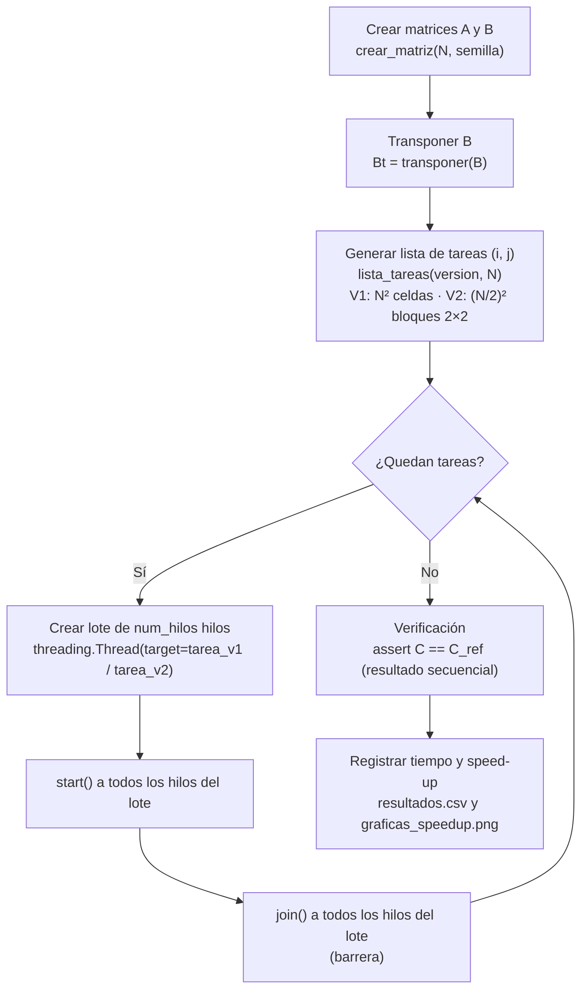

# Multiplicación de matrices con hilos: análisis de tiempo y speed-up

**Materia:** Programación Concurrente, Distribuida y Paralela
**Autor:** [NOMBRE] — [CÓDIGO]
**Fecha:** 7 de octubre de 2026

---

## 1. Objetivo

Implementar en Python la multiplicación de matrices cuadradas `C = A × B` repartiendo el trabajo entre hilos (`threading`) de dos formas:

- **Versión 1 (V1):** cada hilo recibe una fila de A y una columna de B y calcula una celda de C.
- **Versión 2 (V2):** cada hilo recibe dos filas de A y dos columnas de B y calcula un bloque 2×2 de C.

En cada versión los hilos se lanzan por lotes de 2, 4, 8 y 16. Se mide el tiempo total con `time.perf_counter()` y se calcula el speed-up respecto a la versión secuencial para analizar qué tanto ayuda (o perjudica) el uso de hilos en un problema de cálculo puro.

---

## 2. Marco teórico

**Hilo (thread).** Es una unidad de ejecución dentro de un proceso. Todos los hilos de un proceso comparten el mismo espacio de memoria. En Python se crea con `threading.Thread(target=funcion, args=(...))`.

**`start()` y `join()`.** `start()` pone el hilo en ejecución: el sistema operativo lo planifica y ejecuta la función `target`. `join()` bloquea al hilo que lo llama (aquí, el hilo principal) hasta que el hilo indicado termina. Si se llama a `join()` sobre todos los hilos de un grupo, se obtiene una **barrera**: nada continúa hasta que termine el último.

**Memoria compartida.** Como los hilos comparten memoria, todos pueden leer y escribir las mismas estructuras (en este trabajo, las matrices `A`, `Bt` y `C`) sin copiarlas.

**Condición de carrera.** Ocurre cuando dos o más hilos acceden al mismo dato, al menos uno de ellos escribe y el resultado depende del orden en que se intercalen. Se evita con exclusión mutua (`threading.Lock`) o diseñando el programa para que los hilos no escriban sobre el mismo dato.

**GIL (Global Interpreter Lock).** En CPython solo un hilo puede ejecutar bytecode de Python a la vez. Los hilos se turnan el intérprete, así que en tareas limitadas por CPU no se ejecutan en paralelo aunque el equipo tenga varios núcleos.

**Concurrencia vs. paralelismo.** Hay *concurrencia* cuando varias tareas avanzan en periodos de tiempo que se solapan, aunque sea intercalándose en un solo núcleo. Hay *paralelismo* cuando se ejecutan literalmente al mismo tiempo en núcleos distintos. Por el GIL, los hilos de CPython dan concurrencia, pero no paralelismo en código Python puro.

**Speed-up y eficiencia.**

$$S_p = \frac{T_{secuencial}}{T_p} \qquad\qquad E_p = \frac{S_p}{p}$$

donde $T_p$ es el tiempo con $p$ hilos. Si $S_p > 1$ hay ganancia y si $S_p < 1$ el programa es más lento que el secuencial. El caso ideal es $S_p = p$ ($E_p = 1$).

---

## 3. Diseño de la solución

Cada celda de C se calcula como `C[i][j] = Σ_k A[i][k] · B[k][j]`, es decir, la fila `i` de A por la columna `j` de B. Para pasar las columnas con facilidad, B se transpone una sola vez: `Bt[j]` es la columna `j` de B.



**¿Por qué no se necesita `Lock`?** Las tareas forman una partición de la matriz C: en V1 cada hilo escribe solo `C[i][j]`, y en V2 solo las cuatro celdas de su bloque 2×2, sin solaparse con otros bloques porque `i` y `j` avanzan de 2 en 2. Ningún par de hilos escribe en la misma celda. `A` y `Bt` solo se leen. Además, cada hilo asigna un valor completo a una posición de la lista, en lugar de hacer una operación de leer-modificar-escribir sobre un dato compartido (como `total += x`). Así no hay condición de carrera. El `assert C == C_ref` lo comprueba en cada corrida.

---

## 4. Implementación

### 4.1 `multiplicar_fila_columna`

```python
def multiplicar_fila_columna(fila, columna):
    resultado = 0
    for a, b in zip(fila, columna):
        resultado += a * b
    return resultado
```

Es el producto punto entre una fila de A y una columna de B (tomada de `Bt`). `zip` recorre ambas listas a la vez. `resultado` es una variable local de cada llamada, así que cada hilo tiene la suya y no se comparte.

### 4.2 `multiplicar_2filas_2columnas`

```python
def multiplicar_2filas_2columnas(fila1, fila2, col1, col2):
    return (multiplicar_fila_columna(fila1, col1), multiplicar_fila_columna(fila1, col2),
            multiplicar_fila_columna(fila2, col1), multiplicar_fila_columna(fila2, col2))
```

Calcula un bloque 2×2 de C reutilizando la función anterior cuatro veces. Devuelve la tupla `(C[i][j], C[i][j+1], C[i+1][j], C[i+1][j+1])`. Cada hilo hace 4 veces más trabajo que en V1.

### 4.3 `tarea_v1` y `tarea_v2`

```python
def tarea_v1(A, Bt, C, i, j):
    C[i][j] = multiplicar_fila_columna(A[i], Bt[j])


def tarea_v2(A, Bt, C, i, j):
    (C[i][j], C[i][j + 1],
     C[i + 1][j], C[i + 1][j + 1]) = multiplicar_2filas_2columnas(A[i], A[i + 1], Bt[j], Bt[j + 1])
```

Son las funciones que recibe cada hilo como `target`. `threading.Thread` descarta el valor de retorno de la función, por eso el resultado se escribe directamente en la matriz compartida `C`. Las coordenadas `(i, j)` las genera `lista_tareas`, con paso 1 en V1 y paso 2 en V2.

### 4.4 `multiplicar_con_hilos`

```python
def multiplicar_con_hilos(A, Bt, version, num_hilos):
    # ... (n, C vacía y función según la versión)
    tareas = lista_tareas(version, n)
    for inicio in range(0, len(tareas), num_hilos):
        lote = [threading.Thread(target=funcion, args=(A, Bt, C, i, j))
                for i, j in tareas[inicio:inicio + num_hilos]]
        for hilo in lote:
            hilo.start()          # arrancan los num_hilos hilos del lote
        for hilo in lote:
            hilo.join()           # se espera a que TODOS terminen antes del siguiente lote
    return C, len(tareas)
```

Recorre la lista de tareas en bloques de `num_hilos`. Para cada bloque crea un hilo por tarea, los arranca todos y luego espera a todos con `join()`. Así nunca hay más de `num_hilos` hilos de trabajo activos al mismo tiempo. Al terminar, cada tarea tuvo su propio hilo, de modo que el total de hilos creados es igual al número de tareas (10.000 en V1 y 2.500 en V2 para N = 100). La función devuelve ese total, que se registra en la columna `hilos_creados`.

---

## 5. Metodología de medición

| Parámetro | Valor |
|---|---|
| Tamaño de las matrices | 100 × 100 (enteros aleatorios entre 0 y 9, semillas fijas 1 y 2) |
| Configuraciones | V1 y V2, cada una con lotes de 2, 4, 8 y 16 hilos |
| Repeticiones por caso | 3 (`REPETICIONES = 3`) |
| Estadístico reportado | Mediana de las 3 corridas (`statistics.median`) |
| Reloj | `time.perf_counter()` (monotónico, alta resolución) |
| Línea base | `multiplicar_secuencial`, que ejecuta las mismas tareas sin crear hilos |
| Validación | `assert C == C_ref` en cada caso con hilos |

El tiempo medido es el **tiempo total** de la llamada e incluye crear la matriz C vacía, crear los hilos, ejecutarlos y hacer `join()`. La transposición de B se hace una sola vez antes de medir.

**Equipo de prueba:**

- CPU: [CPU]
- Núcleos / hilos lógicos: [NÚCLEOS]
- RAM: [RAM]
- Versión de Python: [VERSIÓN DE PYTHON]
- Sistema operativo: Windows 10 Pro

---

## 6. Resultados

Datos de `resultados.csv`. La eficiencia se calcula como `E = speed-up / hilos por lote`.

| Versión | Hilos por lote | Hilos creados | Tiempo (s) | Speed-up | Eficiencia |
|---|---:|---:|---:|---:|---:|
| V1 (fila × columna) | 2 | 10.000 | 4,0604 | 0,0719 | 0,0360 |
| V1 | 4 | 10.000 | 4,2947 | 0,0680 | 0,0170 |
| V1 | 8 | 10.000 | 3,7463 | 0,0779 | 0,0097 |
| V1 | 16 | 10.000 | 3,8990 | 0,0749 | 0,0047 |
| V2 (2 filas × 2 columnas) | 2 | 2.500 | 1,3171 | 0,2028 | 0,1014 |
| V2 | 4 | 2.500 | 1,2181 | 0,2192 | 0,0548 |
| V2 | 8 | 2.500 | 1,1737 | 0,2275 | 0,0284 |
| V2 | 16 | 2.500 | 1,2307 | 0,2170 | 0,0136 |

El CSV no tiene una columna con el tiempo secuencial, pero se obtiene de él como `T_secuencial = Tiempo × Speed-up`: **0,292 s para V1** y **0,267 s para V2**. Son los mismos valores que muestra la gráfica.


*Figura 1. Izquierda: tiempo total por número de hilos por lote. Las líneas punteadas son el tiempo secuencial. Derecha: speed-up. La línea discontinua marca S = 1.*

---

## 7. Análisis

### 7.1 ¿Por qué el speed-up es menor que 1?

En todos los casos $S < 1$. La versión con hilos tarda entre 12,8 y 14,7 veces más que la secuencial en V1 (speed-up de 0,068 a 0,078) y entre 4,4 y 4,9 veces más en V2 (speed-up de 0,203 a 0,228). Hay dos causas:

1. **GIL.** La multiplicación es cálculo puro en Python. Como solo un hilo puede ejecutar bytecode a la vez, los hilos se turnan y el trabajo útil total sigue siendo secuencial. Los hilos no aportan paralelismo, así que no pueden reducir el tiempo por debajo del secuencial.
2. **Overhead de creación y sincronización.** El trabajo de cada tarea es muy pequeño comparado con el costo de crear, arrancar y esperar un hilo. Con los datos medidos:
   - En la versión secuencial de V1 cada celda cuesta en promedio 0,292 s / 10.000 ≈ **29 µs**.
   - En V1 con hilos el tiempo por hilo creado está entre 3,7463 s / 10.000 ≈ **375 µs** y 4,2947 s / 10.000 ≈ **429 µs**.

   Es decir, por cada celda se gastan alrededor de 350–400 µs en gestionar el hilo, más de 10 veces el trabajo útil. Además, cada lote termina con una barrera (`join()`), y mientras se espera al hilo más lento del lote no se lanza ninguno nuevo.

### 7.2 ¿Por qué no mejora al pasar de 2 a 16 hilos?

Los tiempos varían poco y sin una tendencia clara. En V1 van de 3,75 s a 4,29 s y en V2 de 1,17 s a 1,32 s, y el mejor caso de ambas versiones es el de 8 hilos. Esto es lo esperable:

- Por el GIL, el número de hilos activos no cambia cuánto cálculo se hace en paralelo: siempre es un hilo a la vez.
- El número total de hilos creados **no depende** del tamaño del lote (siempre 10.000 en V1 y 2.500 en V2). Lotes más grandes solo hacen menos barreras, y eso se compensa con más cambios de contexto y más competencia por el GIL dentro de cada lote.
- Las diferencias entre configuraciones (como el pico de 4,29 s en V1 con 4 hilos) son del orden del ruido de medición con solo 3 repeticiones.

Como el speed-up casi no cambia mientras $p$ crece, la eficiencia cae aproximadamente a la mitad cada vez que se duplica $p$: en V1 baja de 0,0360 con 2 hilos a 0,0047 con 16.

### 7.3 Comparación V1 vs. V2: granularidad

| Hilos por lote | T V1 (s) | T V2 (s) | V1 / V2 |
|---:|---:|---:|---:|
| 2 | 4,0604 | 1,3171 | 3,08 |
| 4 | 4,2947 | 1,2181 | 3,53 |
| 8 | 3,7463 | 1,1737 | 3,19 |
| 16 | 3,8990 | 1,2307 | 3,17 |

**V2 es entre 3,1 y 3,5 veces más rápida que V1.** El trabajo aritmético total es el mismo (10.000 productos fila × columna), pero V2 los agrupa en bloques de 4 y crea **4 veces menos hilos** (2.500 frente a 10.000). Como el costo dominante es la gestión de cada hilo, reducir su número reduce el tiempo casi en esa misma proporción.

La mejora no llega a 4× porque cada hilo de V2 trae más trabajo útil. El tiempo por hilo creado en V2 va de 1,1737 s / 2.500 ≈ 469 µs a 1,3171 s / 2.500 ≈ 527 µs, frente a 375–429 µs en V1. Esta es la idea de **granularidad**:

- **Grano fino (V1):** muchas tareas pequeñas, dominadas por el overhead.
- **Grano grueso (V2):** menos tareas y más grandes, de modo que el overhead pesa menos frente al trabajo útil.

---

## 8. Propuestas de mejora

1. **`multiprocessing` (por ejemplo, `multiprocessing.Pool`).** Usa procesos en lugar de hilos. Cada proceso tiene su propio intérprete y su propio GIL, así que sí hay paralelismo real en varios núcleos. En Windows el código que lanza los procesos debe ir dentro de `if __name__ == "__main__":`. Conviene asignar a cada proceso filas completas de C para compensar el costo de enviar datos entre procesos.
2. **`concurrent.futures.ThreadPoolExecutor`.** Crea N hilos una sola vez y los reutiliza para todas las tareas, en lugar de crear 10.000. Elimina la mayor parte del overhead de creación, aunque el GIL sigue impidiendo el paralelismo en cálculo puro.
3. **Grano más grueso.** Que cada hilo o proceso calcule una fila completa de C, o un bloque grande (por ejemplo N/p filas), para que el trabajo por tarea sea mucho mayor que el costo de crearla.
4. **NumPy.** `A @ B` ejecuta la multiplicación en código compilado (BLAS), que libera el GIL y suele usar varios núcleos internamente. Es la opción más rápida en la práctica.
5. **Python *free-threaded* (sin GIL).** Las compilaciones *free-threaded* de CPython (experimentales desde 3.13) permiten que los hilos ejecuten bytecode en paralelo. Repetir el experimento ahí mostraría el efecto del GIL de forma aislada.

---

## 9. Conclusiones

1. Ambas versiones calculan correctamente el producto: en todos los casos el resultado con hilos coincidió con el secuencial (`assert C == C_ref`), sin usar `Lock`, porque cada hilo escribe en celdas distintas de C.
2. Con `threading` en CPython el speed-up fue siempre menor que 1 (0,068–0,078 en V1 y 0,203–0,228 en V2). Los hilos dan concurrencia, pero el GIL impide el paralelismo en cálculo puro.
3. El costo de crear y sincronizar cada hilo (≈ 375–429 µs por hilo en V1) supera ampliamente el trabajo útil por celda (≈ 29 µs), y eso explica la mayor parte del tiempo total.
4. Aumentar el número de hilos por lote de 2 a 16 no mejora el tiempo, y la eficiencia cae aproximadamente a la mitad cada vez que se duplican los hilos.
5. La granularidad es decisiva: agrupar el trabajo en bloques 2×2 (V2) redujo el tiempo entre 3,1 y 3,5 veces. Paralelizar solo compensa cuando el trabajo de cada unidad es mucho mayor que el costo de crearla y coordinarla.
