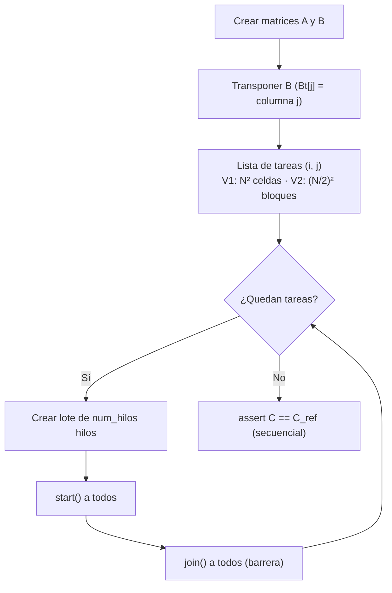
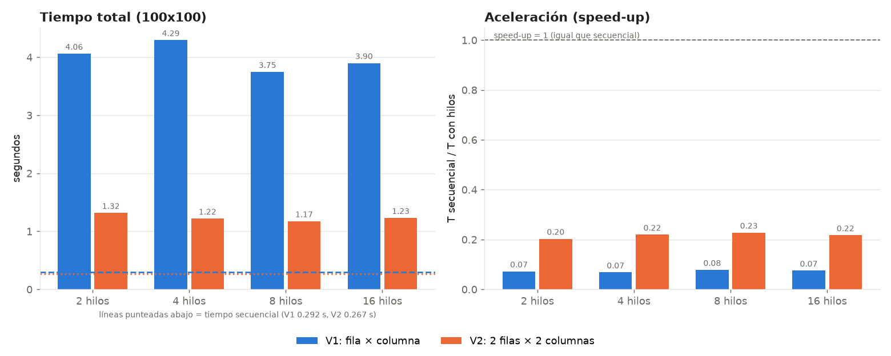

# Multiplicación de matrices con hilos en Python

Taller de **Programación Concurrente, Distribuida y Paralela**. Multiplica matrices `C = A × B` repartiendo el trabajo entre hilos (`threading`) y mide el speed-up frente a la versión secuencial.

- **V1 (fila × columna):** cada hilo recibe una fila de A y una columna de B y calcula **una celda** de C.
- **V2 (2 filas × 2 columnas):** cada hilo recibe dos filas de A y dos columnas de B y calcula **un bloque 2×2** de C.

Los hilos se lanzan **por lotes de 2, 4, 8 y 16**: se crean N hilos, se arrancan todos con `start()`, se espera a todos con `join()` y se pasa al siguiente lote.

## Requisitos

- Python 3.10 o superior
- `matplotlib` (solo para la gráfica)

## Ejecución

**Windows (PowerShell):**

```powershell
python -m venv .venv
.venv\Scripts\Activate.ps1
pip install matplotlib
python matrices_hilos.py
```

**Linux / macOS:**

```bash
python3 -m venv .venv && source .venv/bin/activate
pip install matplotlib
python matrices_hilos.py
```

El tamaño de la matriz es 100×100 por defecto. Se puede cambiar con un argumento, que debe ser **par** por los bloques 2×2 de V2:

```bash
python matrices_hilos.py 60
```

El script genera dos archivos:

| Archivo | Contenido |
|---|---|
| `resultados.csv` | Versión, hilos por lote, hilos creados, tiempo (s) y speed-up |
| `graficas_speedup.png` | Tiempo total y speed-up por número de hilos, V1 vs. V2 |

## Cómo funciona



| Función | Qué hace |
|---|---|
| `multiplicar_fila_columna` | Producto punto de una fila por una columna |
| `multiplicar_2filas_2columnas` | Calcula un bloque 2×2 reutilizando la función anterior |
| `tarea_v1` / `tarea_v2` | Lo que ejecuta cada hilo; escribe el resultado directamente en `C` |
| `multiplicar_con_hilos` | Lanza los hilos por lotes de `num_hilos` con `start()` / `join()` |
| `multiplicar_secuencial` | Las mismas tareas sin hilos (línea base del speed-up) |
| `medir` | Mediana de 3 corridas con `time.perf_counter()` |

No se usa `Lock` porque cada hilo escribe en celdas **distintas** de `C`. `A` y `Bt` solo se leen, así que no hay condición de carrera. Cada resultado se compara con el de la versión secuencial.

## Resultados (100×100, mediana de 3 corridas)

| Versión | Hilos por lote | Hilos creados | Tiempo (s) | Speed-up |
|---|---:|---:|---:|---:|
| V1 | 2 | 10.000 | 4,0604 | 0,072 |
| V1 | 4 | 10.000 | 4,2947 | 0,068 |
| V1 | 8 | 10.000 | 3,7463 | 0,078 |
| V1 | 16 | 10.000 | 3,8990 | 0,075 |
| V2 | 2 | 2.500 | 1,3171 | 0,203 |
| V2 | 4 | 2.500 | 1,2181 | 0,219 |
| V2 | 8 | 2.500 | 1,1737 | 0,228 |
| V2 | 16 | 2.500 | 1,2307 | 0,217 |

Tiempo secuencial: 0,292 s (V1) y 0,267 s (V2).



Los tiempos dependen del equipo. Lo que se debe mantener al repetir el experimento es la tendencia.

## Conclusiones

- **El speed-up es menor que 1:** con hilos el programa es más lento. En CPython el **GIL** solo deja ejecutar un hilo a la vez, así que en cálculo puro no hay paralelismo real. Además, crear y esperar cada hilo (≈ 375–429 µs por hilo en V1) cuesta mucho más que calcular una celda (≈ 29 µs).
- **No mejora de 2 a 16 hilos:** siempre se crea el mismo total de hilos y solo uno calcula a la vez.
- **V2 es entre 3,1 y 3,5 veces más rápida que V1:** crea 4 veces menos hilos para el mismo trabajo. La **granularidad** importa: paralelizar solo vale la pena cuando cada tarea es bastante más costosa que crear el hilo.
- **Para obtener speed-up mayor que 1** se puede usar `multiprocessing` (un GIL por proceso), `ThreadPoolExecutor` (reutiliza los hilos), un grano más grueso o NumPy.

El análisis completo está en [INFORME_MATRICES.pdf](INFORME_MATRICES.pdf) y en [INFORME_MATRICES.md](INFORME_MATRICES.md).

## Estructura

```
.
├── matrices_hilos.py        # código fuente (V1, V2, medición y gráficas)
├── resultados.csv           # resultados de la última ejecución
├── graficas_speedup.png     # gráfica de tiempo y speed-up
├── INFORME_MATRICES.pdf     # informe del taller
├── INFORME_MATRICES.md      # informe en Markdown
└── README.md
```

## Autor

[NOMBRE] — [CÓDIGO]
Programación Concurrente, Distribuida y Paralela
